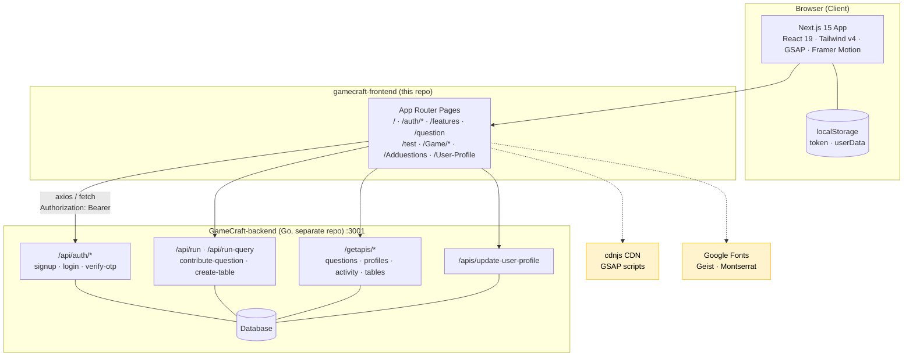
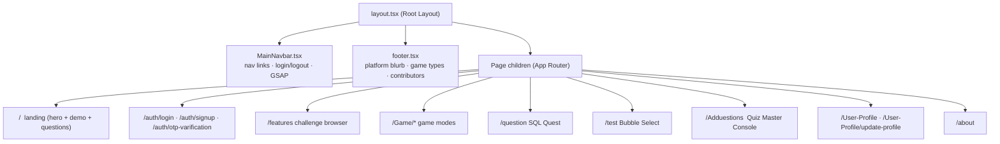
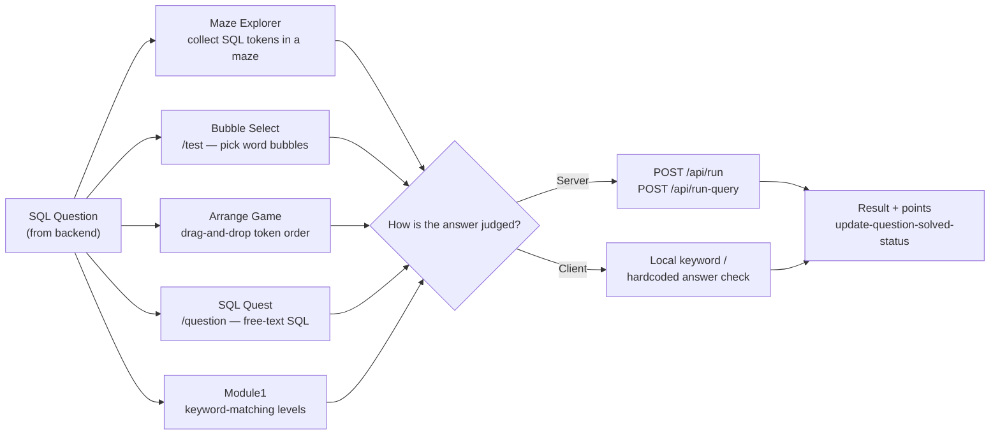
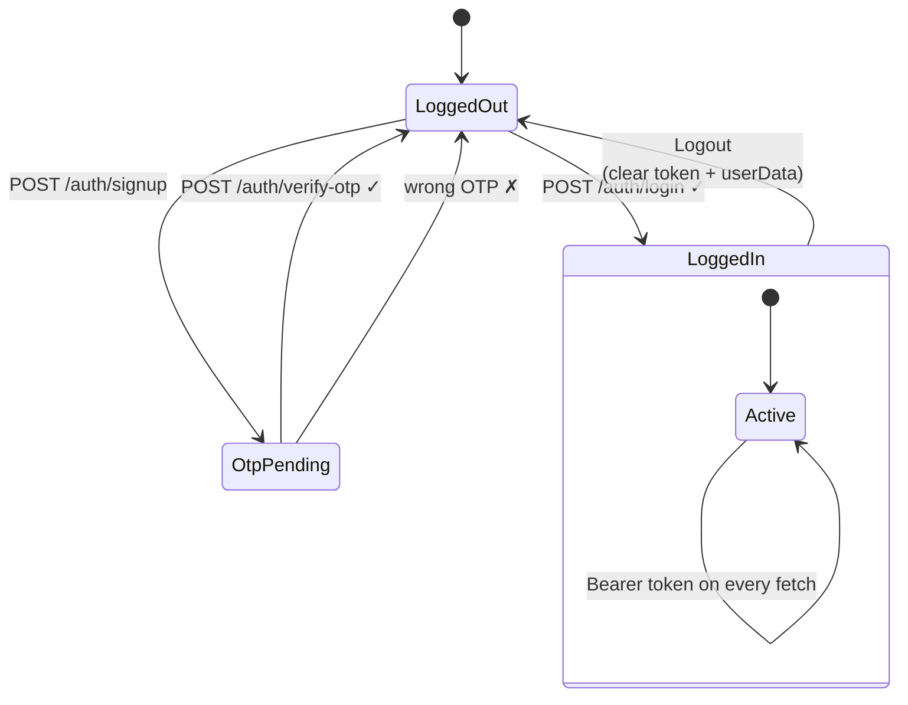
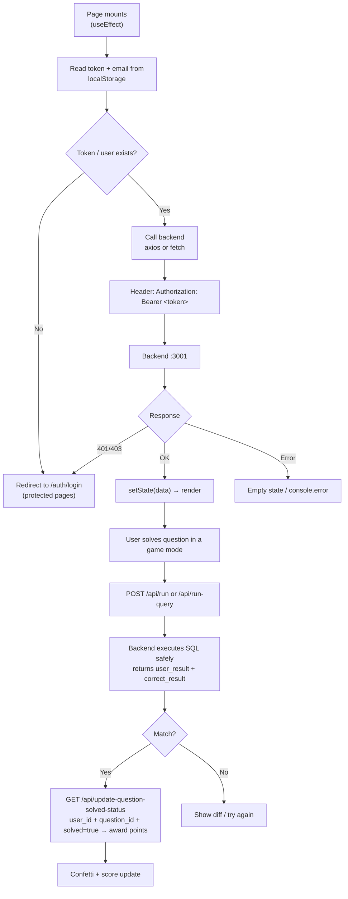
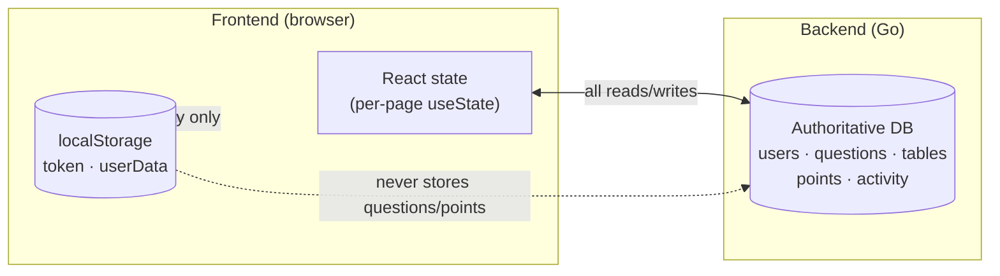
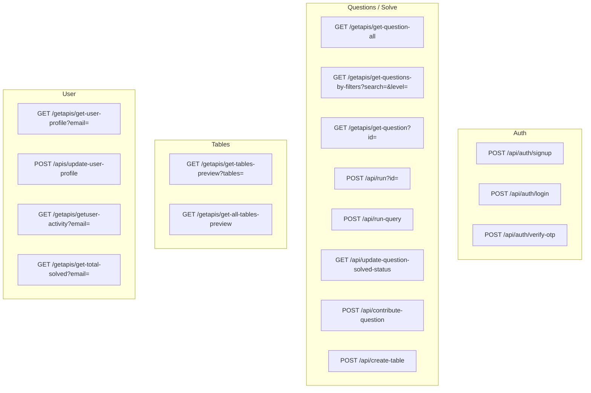
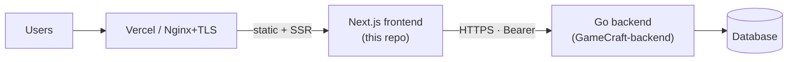

# GameCraft — Frontend

> **GameCraft** is an interactive platform for learning **SQL through play**. Users browse SQL
> challenges (Easy / Medium / Hard), solve them inside multiple game modes (Maze Explorer,
> Bubble Select, Arrange Game, SQL Quest), earn points / levels / streaks, and maintain a
> profile with a GitHub-style activity heatmap.

This repository (`KD-420`) contains the **Next.js 15 frontend** (`gamecraft-frontend/`).
The backend is a separate **Go** service (`GameCraft-backend`, not in this repo) that must run
on `http://localhost:3001`.

---

## Table of Contents

- [Tech Stack](#tech-stack)
- [Project Structure](#project-structure)
- [Architecture (Mermaid)](#architecture-mermaid)
- [Prerequisites](#prerequisites)
- [Setup](#setup)
- [Run Locally](#run-locally)
- [Environment Variables](#environment-variables)
- [Pages & Routes](#pages--routes)
- [Game Modes](#game-modes)
- [Auth Flow (Mermaid)](#auth-flow-mermaid)
- [Data Flow (Mermaid)](#data-flow-mermaid)
- [API Endpoints](#api-endpoints)
- [Scripts Reference](#scripts-reference)
- [Deployment](#deployment)
- [Known Issues / Notes](#known-issues--notes)
- [Team](#team)

---

## Tech Stack

| Area          | Technology                                                             |
| ------------- | ---------------------------------------------------------------------- |
| Framework     | **Next.js 15.5.4** (App Router, `src/app/`)                            |
| UI Library    | **React 19.1.0**                                                       |
| Language      | **TypeScript 5** (strict mode, alias `@/* → ./src/*`)                  |
| Styling       | **Tailwind CSS v4** (`@tailwindcss/postcss`) + CSS-in-JS style blocks  |
| Animation     | **GSAP 3.13** (ScrollTrigger, `@gsap/react`) + **Framer Motion 12**    |
| Drag & Drop   | **@dnd-kit** (core, sortable, modifiers)                               |
| HTTP Client   | **axios** + native `fetch`                                             |
| Icons         | **lucide-react**                                                       |
| State         | React `useState`/`useEffect` + **localStorage** (no Redux/Zustand)     |
| Auth          | Custom JWT-style `token` + `userData` in `localStorage`, OTP verify    |
| Backend       | Go REST API on `http://localhost:3001` (external repo)                 |
| Port          | `3000` (dev server, auto-increments if busy)                           |

> **Note:** `sql.js` and `uuid` are declared in `package.json` but currently **unused** in source
> (likely leftovers from an earlier in-browser SQLite experiment).

---

## Project Structure

```
KD-420/                              # Git repo root
├── README.md                        # ← this file
└── gamecraft-frontend/              # Next.js app
    ├── .env.example                 # env template
    ├── .env.local                  # actual env (gitignored) — copy from .env.example
    ├── Makefile                     # setup / env / install / dev / build / start / lint / clean
    ├── package.json
    ├── next.config.ts
    ├── tsconfig.json                # path alias @/* → ./src/*
    ├── postcss.config.mjs           # Tailwind v4
    ├── eslint.config.mjs
    ├── public/                      # static assets (svg placeholders)
    └── src/
        └── app/                     # App Router — every page is "use client"
            ├── layout.tsx           # Root layout: MainNavbar + children + Footer
            ├── page.tsx             # "/" landing page
            ├── globals.css          # @import "tailwindcss"
            ├── assets/              # images (incl. "Game Chars/")
            ├── auth/
            │   ├── login/page.tsx           # combined Login/Signup slider (real API)
            │   ├── signup/page.tsx          # GSAP signup/contact page (not wired to API)
            │   └── otp-varification/page.tsx# 6-digit OTP verify
            ├── question/page.tsx            # "SQL Quest" free-text SQL submission
            ├── test/page.tsx                # "Bubble Select" word-bubble game
            ├── features/page.tsx            # challenge browser (search + difficulty filter)
            ├── Game/
            │   ├── page.tsx                 # redirect → /features
            │   ├── module1/                 # SQL Adventure Quest (level1 + level2)
            │   ├── mazeExplorer/page.tsx    # DFS maze + SQL token collection
            │   ├── arrangeGame/page.tsx     # dnd-kit token ordering game
            │   ├── test/page.tsx            # vertical-sort arrange variant
            │   └── seneriobased-01/page.tsx # stub → /features
            ├── Adduestions/page.tsx         # "Quiz Master Console" (create tables/questions)
            ├── User-Profile/
            │   ├── page.tsx                 # profile dashboard + activity heatmap
            │   └── update-profile/page.tsx  # edit profile form
            ├── about/page.tsx               # team + features (framer-motion)
            ├── LandingPage/page.tsx         # redirect → /
            ├── okk/page.tsx                 # dev-only heatmap page
            └── components/
                ├── MainNavbar.tsx           # global navbar (login state, GSAP)
                ├── footer.tsx               # global footer
                ├── hero.tsx                 # MySQL hero (loads GSAP from CDN)
                ├── heroSection.tsx          # GSAP ScrollTrigger scroll animations
                ├── LoginModal.tsx / SignupModal.tsx  # mock modals (no API)
                └── QuestionFormates/All-question.tsx # question list + Start Challenge
```

---

## Architecture (Mermaid)

### High-level system architecture



### Component / render tree



---

## Prerequisites

| Tool   | Version                          | Check            |
| ------ | -------------------------------- | ---------------- |
| Node.js | **≥ 18.18** (tested on 20/24)  | `node -v`        |
| npm     | **≥ 9** (tested on 10/11)      | `npm -v`         |
| Make    | any (macOS/Linux; optional)      | `make -v`        |
| Go backend | running on `:3001` (for full functionality) | —       |

> The frontend will **start without the backend**, but all data-driven pages (login, questions,
> games, profile) will fail gracefully / show empty states until the Go backend is running.

---

## Setup

### Option A — Makefile (recommended)

```bash
cd gamecraft-frontend
make setup      # copies .env.example → .env.local (if missing) + npm install
```

### Option B — Manual

```bash
cd gamecraft-frontend
cp .env.example .env.local    # create env file
npm install                   # install dependencies (uses package-lock.json)
```

### Option C — One-liner

```bash
cd gamecraft-frontend && npm install && cp -n .env.example .env.local
```

---

## Run Locally

### 1. Start the Go backend (required for data)

Start your `GameCraft-backend` on **http://localhost:3001** (separate repo — see its own README).

### 2. Start the frontend dev server

```bash
cd gamecraft-frontend
make dev          # or: npm run dev
```

The server starts on **http://localhost:3000**. If port 3000 is busy, Next.js automatically
uses the next available port (e.g. `3001`, `3002`, …) and prints the actual URL.

```text
▲ Next.js 15.5.4
- Local:        http://localhost:3000
- Environments: .env.local
✓ Ready in ~11s
```

### 3. Open the app

Visit **http://localhost:3000** (or the port shown in your terminal).

### Seeded demo account

| Field    | Value                |
| -------- | -------------------- |
| Email    | `demo@gamecraft.dev` |
| Password | `password123`        |

(Requires the Go backend + its seeded database to be running.)

### Other useful commands

```bash
make build      # production build (next build)
make start      # serve the production build (next start)
make lint       # run ESLint
make clean      # remove .next/ and node_modules/
make env        # (re)create .env.local from .env.example
make help       # list all make targets
```

---

## Environment Variables

Create `gamecraft-frontend/.env.local`:

```bash
# Base URL of the GameCraft backend API.
NEXT_PUBLIC_API_URL=http://localhost:3001
NEXT_PUBLIC_API_BASE_URL=http://localhost:3001
```

| Variable                     | Default                   | Used by                                      |
| ---------------------------- | ------------------------- | -------------------------------------------- |
| `NEXT_PUBLIC_API_URL`        | `http://localhost:3001`   | Almost all pages (auth, questions, games, profile) |
| `NEXT_PUBLIC_API_BASE_URL`   | `http://localhost:3001`   | Only `Adduestions/page.tsx`                  |

> ⚠️ **`NEXT_PUBLIC_*` values are inlined at build time.** After changing them, restart the dev
> server / rebuild. For production, set them in your hosting provider's env settings **before**
> building.

---

## Pages & Routes

| Route                        | Page                                   | Description                                                        |
| ---------------------------- | -------------------------------------- | ------------------------------------------------------------------ |
| `/`                          | `app/page.tsx`                         | Landing: MySQL hero (GSAP), game demo, question list, scroll sections |
| `/LandingPage`               | `LandingPage/page.tsx`                 | Client redirect → `/`                                              |
| `/auth/login`                | `auth/login/page.tsx`                  | Combined Login/Signup slider; real API calls; stores token+user    |
| `/auth/signup`               | `auth/signup/page.tsx`                 | GSAP signup/contact page (**not wired to API** — console.log only) |
| `/auth/otp-varification`     | `auth/otp-varification/page.tsx`       | 6-digit OTP → `POST /api/auth/verify-otp` → login                 |
| `/features`                  | `features/page.tsx`                    | Challenge browser: search, Easy/Med/Hard filter, stats, game links |
| `/Game`                      | `Game/page.tsx`                        | Client redirect → `/features`                                      |
| `/Game/module1`              | `Game/module1/page.tsx`                | "SQL Adventure Quest" module runner (level1 → level2)             |
| `/Game/mazeExplorer`         | `Game/mazeExplorer/page.tsx`           | DFS-generated maze; collect SQL tokens on solution path           |
| `/Game/arrangeGame`          | `Game/arrangeGame/page.tsx`            | dnd-kit drag-and-drop SQL token ordering (`?id` or hardcoded)     |
| `/Game/test`                 | `Game/test/page.tsx`                   | Vertical-sort variant of the arrange game                         |
| `/Game/seneriobased-01`      | `Game/seneriobased-01/page.tsx`        | Stub redirect → `/features`                                       |
| `/question`                  | `question/page.tsx`                    | "SQL Quest": free-text SQL submission → `POST /api/run`           |
| `/test`                      | `test/page.tsx`                        | **Bubble Select** game: word bubbles → query → `POST /api/run-query` |
| `/Adduestions`               | `Adduestions/page.tsx`                 | "Quiz Master Console": create tables, preview, add questions      |
| `/User-Profile`              | `User-Profile/page.tsx`                | Profile dashboard: level, rank, badges, activity heatmap, logout  |
| `/User-Profile/update-profile` | `User-Profile/update-profile/page.tsx` | Edit username / socials / skills / phone                          |
| `/about`                     | `about/page.tsx`                       | Contributors + feature cards (framer-motion)                      |
| `/okk`                       | `okk/page.tsx`                         | Dev-only 365-day activity heatmap page                            |

---

## Game Modes



| Game                | Path                    | Mechanism                                                        |
| ------------------- | ----------------------- | ---------------------------------------------------------------- |
| **Maze Explorer**   | `/Game/mazeExplorer`    | DFS maze; SQL tokens scattered on solution path; assemble query  |
| **Bubble Select**   | `/test`                 | Floating word bubbles → build query (or manual mode); server judges |
| **Arrange Game**    | `/Game/arrangeGame`     | dnd-kit ordering of SQL tokens; `?id` or 3 hardcoded queries     |
| **SQL Quest**       | `/question`             | Textarea for SQL → `POST /api/run`; blocks DROP/DELETE/TRUNCATE  |
| **Module1**         | `/Game/module1`         | Keyword-matching levels (client-side judging)                    |

---

## Auth Flow (Mermaid)

### Signup → OTP → Login sequence

```mermaid
sequenceDiagram
    actor U as User
    participant FE as Frontend (Next.js)
    participant BE as Backend (Go :3001)
    participant LS as localStorage

    rect rgb(235, 245, 255)
    note over U,BE: Signup
    U->>FE: Submit signup form (/auth/login)
    FE->>BE: POST /api/auth/signup
    BE-->>FE: 201 Created (OTP sent to email)
    FE->>FE: redirect → /auth/otp-varification
    end

    rect rgb(235, 255, 240)
    note over U,BE: OTP Verification
    U->>FE: Enter 6-digit OTP
    FE->>BE: POST /api/auth/verify-otp { email, otp }
    BE-->>FE: OK
    FE->>FE: redirect → /auth/login
    end

    rect rgb(255, 245, 235)
    note over U,LS: Login
    U->>FE: Enter credentials
    FE->>BE: POST /api/auth/login { Id, password }
    BE-->>FE: { token, user }
    FE->>LS: localStorage.setItem("token", token)
    FE->>LS: localStorage.setItem("userData", JSON(user))
    FE->>FE: redirect → /User-Profile
    end

    rect rgb(245, 235, 255)
    note over FE,LS: Authenticated requests
    FE->>LS: read token + userData
    FE->>BE: GET/POST … with header<br/>Authorization: Bearer &lt;token&gt;
    BE-->>FE: protected data
    end
```

### Session state (client-side)



> **Logout:** `MainNavbar` and `User-Profile` clear `localStorage["token"]` and
> `localStorage["userData"]`, then redirect to `/auth/login`.

---

## Data Flow (Mermaid)

### Request lifecycle



### Where data lives



- **Frontend stores nothing persistent** beyond `token` + `userData` in `localStorage`.
- **All authoritative data** (users, questions, tables, points, activity) lives in the Go backend DB.
- **Judging:** server-side for `/question` + `/test`; client-side for `Game/module1` and hardcoded arrange/maze games.

---

## API Endpoints

Base URL = `NEXT_PUBLIC_API_URL` (default `http://localhost:3001`).



| Method | Endpoint                                          | Purpose                                   | Auth |
| ------ | ------------------------------------------------- | ----------------------------------------- | ---- |
| POST   | `/api/auth/signup`                                | Register (triggers OTP email)             | —    |
| POST   | `/api/auth/login`                                 | Login → `{ token, user }`                 | —    |
| POST   | `/api/auth/verify-otp`                            | Verify email OTP                          | —    |
| GET    | `/getapis/get-question-all`                       | All questions                             | Bearer |
| GET    | `/getapis/get-questions-by-filters`               | Filtered question list                    | Bearer |
| GET    | `/getapis/get-question?id=`                       | Single question (+ Answer, UsedTables, Points) | Bearer |
| POST   | `/api/run?id=`                                    | Execute submitted SQL (SQL Quest)         | Bearer |
| POST   | `/api/run-query`                                  | Execute query (Bubble Select)             | Bearer |
| GET    | `/api/update-question-solved-status`              | Mark solved + award points                | Bearer |
| POST   | `/api/contribute-question`                        | Community question submission             | Bearer |
| POST   | `/api/create-table`                               | Create a DB table (Quiz Master Console)   | Bearer |
| GET    | `/getapis/get-tables-preview?tables=`             | Preview specific tables                   | Bearer |
| GET    | `/getapis/get-all-tables-preview`                 | Preview all tables                        | Bearer |
| GET    | `/getapis/get-user-profile?email=`                | Fetch profile                             | Bearer |
| POST   | `/apis/update-user-profile`                       | Update profile                            | Bearer |
| GET    | `/getapis/getuser-activity?email=`                | Activity heatmap data                     | Bearer |
| GET    | `/getapis/get-total-solved?email=`                | Per-difficulty stats + points             | Bearer |

> ⚠️ The backend uses **three inconsistent prefixes**: `/api/*`, `/getapis/*`, `/apis/*`.
> This is intentional backend behavior — do not "fix" it in the frontend without coordinating.

---

## Scripts Reference

### package.json

| Script    | Command         | Description                    |
| --------- | --------------- | ------------------------------ |
| `dev`     | `next dev`      | Start dev server (port 3000+)  |
| `build`   | `next build`    | Production build               |
| `start`   | `next start`    | Serve production build         |
| `lint`    | `eslint`        | Run ESLint                     |

### Makefile targets

| Target    | Description                                      |
| --------- | ------------------------------------------------ |
| `help`    | List all targets                                 |
| `setup`   | One-shot: env file + npm install                 |
| `env`     | Create `.env.local` from `.env.example` if missing |
| `install` | `npm install`                                    |
| `dev`     | `npm run dev`                                    |
| `build`   | `npm run build`                                  |
| `start`   | `npm run start`                                  |
| `lint`    | `npm run lint`                                   |
| `clean`   | `rm -rf .next node_modules`                      |

---

## Deployment

There is **no** `vercel.json`, `Dockerfile`, or CI config in this repo yet. Below are the three
supported paths.

### Option A — Vercel (recommended for the frontend)

Vercel is the makers of Next.js — zero-config deploys.

```bash
# 1. Install Vercel CLI (once)
npm i -g vercel

# 2. From gamecraft-frontend/, link the project
cd gamecraft-frontend
vercel link

# 3. Set env vars for Production
vercel env add NEXT_PUBLIC_API_URL production        # e.g. https://your-backend.example.com
vercel env add NEXT_PUBLIC_API_BASE_URL production   # same value

# 4. Deploy
vercel --prod
```

Or connect the GitHub repo in the Vercel dashboard:

1. Import `KD-420` → set **Root Directory** = `gamecraft-frontend`
2. Framework preset: **Next.js** (auto-detected)
3. Add the two `NEXT_PUBLIC_*` env vars pointing to your **deployed Go backend URL**
4. Deploy

> ⚠️ Because `NEXT_PUBLIC_*` values are inlined at **build time**, redeploy after any env change.

### Option B — Self-hosted Node server (VPS / VM)

```bash
# On the server (Node ≥ 18.18 required)
git clone <repo> && cd KD-420/gamecraft-frontend

cp .env.example .env.local
# Edit .env.local → point NEXT_PUBLIC_API_URL to your public backend URL
npm ci                 # reproducible install from package-lock.json
npm run build          # next build

# Run behind a process manager
npm i -g pm2
pm2 start npm --name "gamecraft-frontend" -- start
pm2 save && pm2 startup
```

Serve on port 3000 and put **Nginx / Caddy** in front for HTTPS:

```nginx
# nginx site snippet
server {
    listen 443 ssl;
    server_name app.example.com;
    # ssl_certificate ...; ssl_certificate_key ...;

    location / {
        proxy_pass http://127.0.0.1:3000;
        proxy_http_version 1.1;
        proxy_set_header Upgrade $http_upgrade;
        proxy_set_header Connection "upgrade";
        proxy_set_header Host $host;
    }
}
```

### Option C — Docker (build your own image)

Create `gamecraft-frontend/Dockerfile`:

```dockerfile
# ---- deps ----
FROM node:20-alpine AS deps
WORKDIR /app
COPY package.json package-lock.json ./
RUN npm ci

# ---- build ----
FROM node:20-alpine AS builder
WORKDIR /app
COPY --from=deps /app/node_modules ./node_modules
COPY . .
# NEXT_PUBLIC_* are inlined at build time — pass as build args:
ARG NEXT_PUBLIC_API_URL
ARG NEXT_PUBLIC_API_BASE_URL
ENV NEXT_PUBLIC_API_URL=$NEXT_PUBLIC_API_URL
ENV NEXT_PUBLIC_API_BASE_URL=$NEXT_PUBLIC_API_BASE_URL
RUN npm run build

# ---- run ----
FROM node:20-alpine AS runner
WORKDIR /app
ENV NODE_ENV=production
COPY --from=builder /app/.next ./.next
COPY --from=builder /app/node_modules ./node_modules
COPY --from=builder /app/package.json ./package.json
EXPOSE 3000
CMD ["npm", "start"]
```

Build & run:

```bash
cd gamecraft-frontend
docker build \
  --build-arg NEXT_PUBLIC_API_URL=https://api.example.com \
  --build-arg NEXT_PUBLIC_API_BASE_URL=https://api.example.com \
  -t gamecraft-frontend .
docker run -p 3000:3000 gamecraft-frontend
```

### Deployment checklist

- [ ] Go backend deployed and reachable over **HTTPS**
- [ ] `NEXT_PUBLIC_API_URL` + `NEXT_PUBLIC_API_BASE_URL` set to the public backend URL **before build**
- [ ] Frontend rebuilt/redeployed after any env change (values are build-time inlined)
- [ ] CORS on the Go backend allows the frontend origin
- [ ] Backend DB seeded (incl. demo account if needed)
- [ ] HTTPS enabled (Vercel auto / Nginx+Let's Encrypt for self-host)



---

## Known Issues / Notes

1. **`fetch("/api/getTables")`** in `Adduestions/page.tsx` — no matching Next.js API route → will 404.
2. **URL typo** `GET …/api/get-tables-preview-all}` (trailing `}`) in `Adduestions/page.tsx`.
3. **`import { env } from "process"`** in a client component (`Adduestions/page.tsx`) — `env.NEXT_PUBLIC_API_BASE_URL` is not build-inlined in the browser; always falls back to `localhost:3001`.
4. **`layout.tsx`** renders `<MainNavbar>` / `<Footer>` outside `<body>` (invalid HTML / hydration risk); metadata still says "Create Next App".
5. **Inconsistent API prefixes:** `/api/*`, `/getapis/*`, `/apis/*` — backend contract, not a frontend bug.
6. **Folder/route typos** (intentional in code): `Adduestions`, `seneriobased-01`, `otp-varification`.
7. **`auth/signup`** page does not call any API; `LoginModal`/`SignupModal` are mock UIs; `auth/loginForm.tsx` is empty (0 bytes).
8. **`sql.js` + `uuid`** are installed but unused in source.
9. **Two env var names** exist because `Adduestions/page.tsx` reads a different variable than every other file.
10. **No SSR data fetching** — every page is `"use client"`; the app is effectively a client-rendered SPA behind Next.js routing.

---

## Team

| Name            | Role                                   |
| --------------- | -------------------------------------- |
| Gaurav Kumar    | UI, Backend (Go)                       |
| Gagan Verma     | Game Designer, Backend                 |
| Kuldeep Sharma  | Full Stack                             |

See `/about` in the running app for the feature overview.

---

## Quick Start (TL;DR)

```bash
git clone <this-repo>
cd KD-420/gamecraft-frontend
make setup                 # .env.local + npm install
# start Go backend on :3001 in another terminal
make dev                   # http://localhost:3000
```

Demo login: **`demo@gamecraft.dev` / `password123`**
